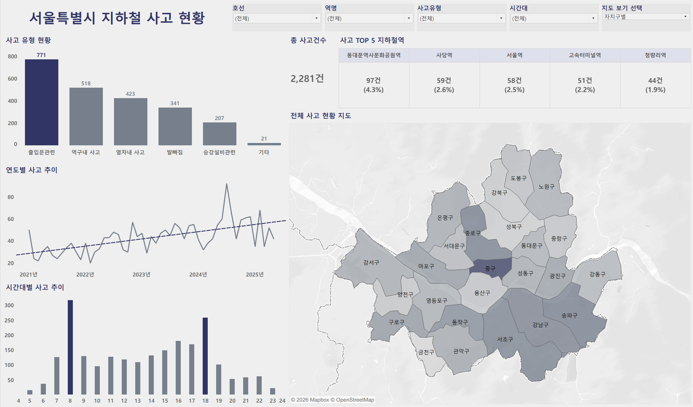

# Dashboard

서울특별시 지하철 사고 현황을 사고 유형, 발생 시점, 발생역 및 지역별로 탐색할 수 있도록 Tableau로 제작한 대시보드입니다.

## 주요 구성

- 사고 유형별 발생 건수
- 전체 사고 건수 및 사고 다발 상위 5개 역
- 연도별 사고 발생 추이
- 시간대별 사고 발생 분포
- 서울시 자치구별 사고 현황 지도
- 호선·역명·사고유형·시간대 필터
- 자치구별·지하철역별 지도 전환

## Tableau Public

[대시보드 바로가기](https://public.tableau.com/app/profile/.79502505/viz/_17859187213230/1?publish=yes)

## 제공 자료

- Tableau Public 대시보드
- 대시보드 미리보기 이미지

> 대시보드는 서울교통공사 지하철 사고 데이터를 기반으로 제작했습니다.
